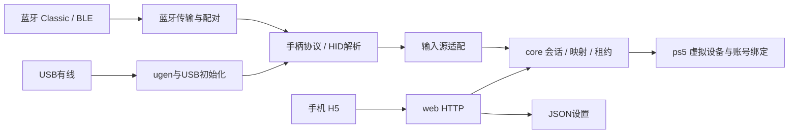

# UniController C11 设计

## 边界与目录

采用 C11 + 离线 HTML/CSS/JavaScript，单一 payload、单事件循环。保留四个顶层源码模块，不照搬Linux内核的总线注册与模块框架。

```text
src/core/                    统一会话、映射、分级日志、租约与失败清理
  pad.h                      传输无关的手柄输入/输出状态
src/drivers/
  bt.c / usb.c               各输入源的薄适配：启停、连接状态到core会话的转换
  bluetooth/                 配对、密钥、Classic/LE链路、HCI、重组
  usb/                       ugen传输、枚举、接口/端点、USB初始化与有线报文适配
  protocols/                 共享Nintendo/Sony/Xbox协议、通用HID解析与内置controllers.json
  common/                    驱动共享字节序、时钟、校验与日志工具
src/ps5/                     虚拟设备创建/输入/删除、账号绑定、电源观察
src/web/                     HTTP、鉴权、静态资源、设置与控制API
```

配对管理属于蓝牙连接层，USB不依赖它。HCI/ACL重组与L2CAP/GATT解包属于蓝牙传输层；HID报告中的按键、摇杆、电量解析属于协议层。USB端点收发与USB专用握手在USB适配层，复用已经去除蓝牙帧头的Nintendo输入报告解析。Xbox360有线20字节协议与Xbox蓝牙格式分别处理。

core唯一持有虚拟输出会话并负责映射、顺序、超时与重试清理；驱动源只保存自己的连接与会话令牌，不能绕过core调用PS5创建/提交/删除。ps5适配层不打开实体手柄，网页不直接访问驱动内部状态。bt.c/usb.c中仍有各自源生命周期的薄适配，暂不增加通用驱动插件注册框架。



## 生命周期与资源

默认关闭，选择已登录账号后手动启动。创建前电源必须明确为工作且持续5秒。蓝牙与USB合计最多四个实体会话，独立账号、输入序号及反馈；网页测试输入独占。注册过程串行，现有会话继续处理输入。实体源首次有效输入后才创建虚拟手柄；慢识别可以中性完成，过期的按键不重放。

待机同时停用实体源、释放并删除自有虚拟手柄；恢复后默认不自动注册或重开传输；蓝牙自动启动支持桌面登录后及休眠恢复后两种策略，均延迟5秒。桌面策略要求新焦点事件及前台/绑定账号已登录；实验恢复策略允许未登录时创建一只未由应用绑定的虚拟手柄并注入按键，由PS5用户选择流程处理账号（实机待验证）；此输出与本应用其他输出互斥。详情见蓝牙说明。常规账号绑定模式在所选账号退出时停用；实验模式保留输出以测试系统用户切换。传输关闭不因虚拟设备删除失败而被阻塞；失败的自有虚拟句柄保留供重试，不能猜测或删除系统设备。

单事件循环，所有 backend/core API 仅允许同线程调用。HTTP最多8个连接，大小和存活时间受限。USB初始化按poll推进，读包每轮最多8次，枚举与健康检查受限。蓝牙HCI启动仍包含有界同步等待，启动等待期间观察电源与会话超时；HTTP可能短暂停顿。

不reset/detach系统驱动、不提高线程优先级。USB接口占用或所有权ioctl不支持时拒绝接入。共享HCI共存行为与PS5的ugen接口仍需实机验证。

## 输入与输出

标准按键采用ScePad布局，Cross14、Circle13、PS16。Switch / PS·Xbox 面键布局切换（A/B 与 X/Y）后执行32位映射。设置仅允许全部输入源关闭时修改。

网页输入要求session、递增sequence和完整状态，500ms无有效输入自动释放。USB可能只在变化时上报，独立连接健康检查可续期已成功提交状态的租约，不增加输入帧数/序号、不重复提交报文；超过500ms的调度中断不能续期旧按键。断线/健康检查失败直接清理。Nova原生ID可能对应接收器，不能仅凭USB节点存在就续期旧按键，仍要求500ms内实际输入；稀疏上报固件需实测。蓝牙当前仍保留500ms输入静默释放，稀疏上报型号后续单独验证。

PS5输出仍通过libScePad创建、注入和删除，通过日志严格识别自有设备后用libSceMbus绑定账号。直接/dev/hid输出是独立改造，本次未替换。手机模拟手柄没有马达；实体连接短震动与游戏震动回传是两个功能，游戏反馈按会话读取并转发，单台反馈读取失败不影响其他设备及输入。

## 设备配置

协议绑定、型号名称、命名 HID 字段布局和 USB 特殊标记由源码 `src/drivers/protocols/controllers.json` 维护，构建时严格校验生成 C 表。内置 layout 只有 bindings，描述协议字段与标准轴角色，不提供用户方向反转选项。

用户可另行通过 FTP 上传 `/data/unicontroller/controllers.json`。使用固定版本 LibJSON 0.2.5 的事件解析器，最多 32 KiB、32 条精确 transport/VID/PID 规则；只在启动加载一次，无热重载。缺文件正常使用内置规则，任一非法字段、未知 profile 或无效匹配使整份覆盖回退内置并记录日志。没有网页写入 JSON 的 API。

覆盖可提供 ASCII 显示别名、既有 profile hint 和原始通用 HID mapping；不能定义新协议、脚本、原始命令或组合键。USB hint 仍需满足受支持接口描述符，不绕过 Sony/内核驱动保护。型号别名不认证制造商。

settings.json 仍保存 UI/core 偏好，当前支持 Switch / PS·Xbox 面键布局切换（A/B 与 X/Y）与全局 32 位按键映射，没有新增每会话轴反转。协议字段绑定、用户映射和设备身份是不同层次。详见[手柄配置](controller-config.md)。

## HTTP、存储与日志

/api/v1/system、session、users、settings、logs、diagnostics、test-controller、bluetooth、usb；写操作使用随机令牌及精确Origin/Host校验，无通配CORS。静态页 /、/controller、/settings；暂用有界HTTP轮询。

settings.json版本1，完整校验后私有临时文件+sync+rename。蓝牙bonds.db独立保存，0600权限，不修改系统配对数据库。USB不保存配对密钥。

记录级别与页面过滤级别独立，Off/Error/Warn/Info/Debug/Trace。输入源启停、协议匹配、初始化、设备识别、账号绑定、清理与错误需可追踪，不记录令牌、密钥或无限量原始载荷。

主机测试与CI编译不能证明原生游戏输入和原装手柄共存。验收见validation.md与usb.md。
